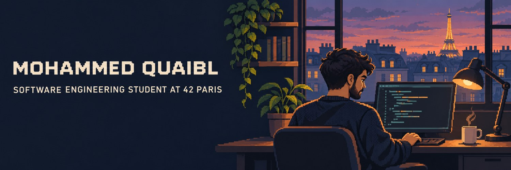

# Mohammed Quaibl

**42 Paris Student · Web Application Development · IT & Project Management**

## About me

I'm a software engineering student at 42 Paris with experience in web
application development, IT support, and project management. I hold a
master’s degree in ICT and Management and have worked in technical and
management roles in Algeria, Italy, and Niger.

My web development work has included building responsive interfaces
with Angular and TypeScript, integrating REST APIs, and collaborating
with backend developers. My background in IT support and networking
has taught me to consider how software fits into the way people work.

## Technical interests

I'm interested in Python, applied AI, and backend development,
especially in building tools that solve everyday problems. At 42 Paris,
I'm strengthening my foundations in C, algorithms, and Unix.

| Area | Experience and interests |
| --- | --- |
| Applied AI and backend | Python, applied AI, and backend development |
| Web applications | Angular, TypeScript, responsive interfaces, and REST APIs |
| Software engineering | C, algorithms, Unix, and Git |
| IT and project management | Technical support, networking, and project coordination |

## Languages

| Language | Proficiency |
| --- | --- |
| Arabic | 🔵 🔵 🔵 🔵 🔵 🔵 |
| French | 🔵 🔵 🔵 🔵 ⚪ ⚪ |
| English | 🔵 🔵 🔵 ⚪ ⚪ ⚪ |
| Italian | 🔵 ⚪ ⚪ ⚪ ⚪ ⚪ |
